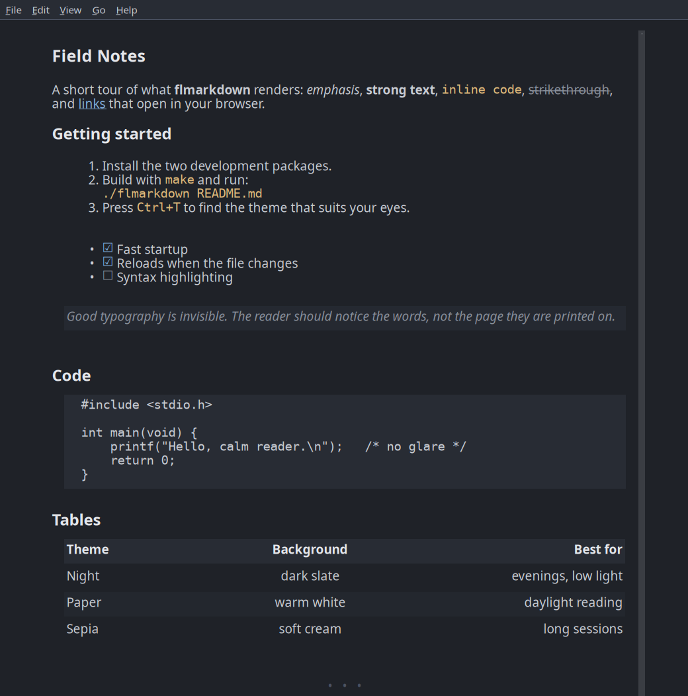
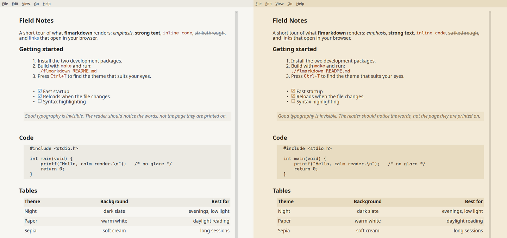
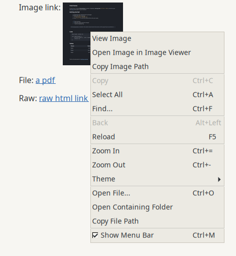

# flmarkdown

**A calm, lightweight Markdown viewer for Linux.**

flmarkdown opens a `.md` file and shows it as a clean, readable page: soft colors, a comfortable line length, and none of a browser's or editor's clutter. It's a single small native program (about 180 KB), built with [FLTK](https://www.fltk.org/) and [md4c](https://github.com/mity/md4c).





## Features

- **Easy on the eyes.** Three themes: Night, Paper and Sepia. None uses pure black or pure white, so the contrast never glares. The text stays in a centered column of about 80 characters, however wide the window is.
- **Proper typography.** Noto Sans for text and DejaVu Sans Mono for code (both configurable), shaded code blocks and quotes, striped tables, and checkbox glyphs for task lists.
- **GitHub-flavored Markdown.** Tables (with column alignment), task lists, strikethrough, autolinks, fenced code, and `[[wiki links]]`.
- **Live reload.** Save the file in your editor and the page updates, keeping your scroll position.
- **Everything in menus.** A menu bar and a right-click menu list every action with its shortcut, so you never need to memorize keys. Right-click a link to open or copy it. The menu bar can be hidden (`Ctrl+M`) for a fully clean page.
- **Links that work.** Links to other `.md` files and to images open inside the viewer (with Back), `#heading` links jump within the page, and web links open in your browser.
- **Find that shows you where.** Every match is marked on the page, the current one is highlighted, and the find bar counts them ("3 of 12").
- **Zoom, recent files and keyboard scrolling.** It remembers your theme, text size, window size and recently opened files.
- **Desktop integration.** A menu entry with an icon, and **Open With** for `.md` files in your file manager (tested with Thunar and SpaceFM on XFCE; others that follow the XDG standards should work too). Drag and drop works too.
- **Safe by design.** It never fetches anything from the network, and only opens a link when you click it.



## Install

### 1. Dependencies

You need a C++17 compiler, `make`, and the development packages for **FLTK 1.4** and **md4c**.

On Debian or Ubuntu (tested on Ubuntu 26.04):

```sh
sudo apt install build-essential libfltk1.4-dev libmd4c-dev
```

On other distributions, install the FLTK 1.4 and md4c development packages (the names vary). FLTK must be **1.4 or newer** (developed against 1.4.4); older 1.3 releases aren't supported. If you built FLTK yourself, point the build at it with `make FLTK_CONFIG=/path/to/fltk-config`.

### 2. Build and install

```sh
git clone https://github.com/chelovek84/flmarkdown.git
cd flmarkdown
make
sudo make install
```

This installs to `/usr/local`: the program, a menu entry (under **Accessories**), icons, and docs.

To make flmarkdown the default app for `.md` files, so a double-click opens it, run this as your normal user, without sudo:

```sh
make default
```

**Install just for yourself, without root:**

```sh
make PREFIX=~/.local install
```

`~/.local/bin` must be on your `PATH`.

## Usage

```sh
flmarkdown README.md
flmarkdown --theme paper notes.md
flmarkdown            # opens a welcome page; press Ctrl+O to pick a file
```

You can also drop a file onto the window, or right-click a `.md` file in your file manager and choose **Open With → flmarkdown**.

Every action is in the **menu bar** (File, Edit, View, Go, Help) and most are also in the **right-click menu**. **Help → Keyboard Shortcuts** (`F1`) shows the full list of keys inside the app.

### Keyboard

| Key | Action |
|:--|:--|
| `Ctrl+O` | Open a file |
| `Ctrl+F` or `/` | Find. `Enter` or `F3` goes to the next match, `Shift+Enter` or `Shift+F3` to the previous one, `Esc` closes |
| `Ctrl+=` / `Ctrl+-` / `Ctrl+0` | Larger / smaller / default text size |
| `Ctrl+T` | Next theme: Night → Paper → Sepia |
| `Ctrl+M` | Show or hide the menu bar |
| `Ctrl+C` / `Ctrl+A` | Copy selected text / select all |
| `F1` | Keyboard shortcuts |
| `F5` or `Ctrl+R` | Reload (it also reloads automatically when the file changes) |
| `Alt+Left` or `Backspace` | Go back after following a link |
| `Space` / `Shift+Space`, `PgDn` / `PgUp` | Scroll by a page |
| `↓` / `↑`, `j` / `k` | Scroll by a line |
| `Home` / `End`, `g` / `G` | Top / bottom |
| `q` or `Ctrl+Q` | Quit |

### Fonts

The default fonts are Noto Sans and DejaVu Sans Mono. To use others, set environment variables:

```sh
FLMD_FONT="Inter" FLMD_MONO="JetBrains Mono" flmarkdown README.md
```

Settings (theme, text size, window size, menu bar, recent files) are saved in `~/.config/flmarkdown/flmarkdown.prefs`.

## Make targets

| Command | What it does |
|:--|:--|
| `make` | Build `./flmarkdown` |
| `make run FILE=docs/sample.md` | Build and open a file |
| `sudo make install` | Install the program, menu entry, icons and docs, then refresh the desktop caches |
| `sudo make uninstall` | Remove everything `install` added |
| `make default` / `make undefault` | Set or unset flmarkdown as your `.md` viewer (per user, no sudo) |
| `make clean` | Remove build files |
| `make test` | Run the self-test (see [Development](#development)) |
| `make icons` | Regenerate the icons from `data/icons/flmarkdown.svg` (needs ImageMagick) |
| `make help` | List all targets |

The standard variables work as usual: `PREFIX`, `DESTDIR` (for packaging), `CXX`, `CXXFLAGS`, `LDFLAGS`.

## What it doesn't do

flmarkdown displays pages with FLTK's built-in HTML widget, which is fast and small but simple. In practice that means:

- **No syntax highlighting.** Code is monospace on a shaded background.
- **No images from the web.** Local images display, scaled to fit. Remote images, such as README badges, are left out.
- **No math rendering.** `$…$` math is shown as text.
- **Fixed line spacing and heading sizes.**
- **Wrapped code.** Code lines that don't fit are wrapped rather than scrolled sideways. Inside lists and quotes, tables are drawn as aligned plain text.

It's meant for *reading* READMEs, notes and docs, not as a full browser-grade renderer. If you need pixel-perfect GitHub rendering, a WebKit-based viewer is a better fit.

## How it works

md4c parses the Markdown, and a custom renderer (`src/render.cpp`) turns it into HTML designed for what Fl_Help_View can display. Code and quote backgrounds are table cells, strikethrough uses combining characters, heading anchors use GitHub's naming, and so on. The renderer also works around several Fl_Help_View bugs: it never puts a table inside a list item (that makes FLTK 1.4.4 hang), wraps code to the measured width, and breaks overly long words, so a page is never wider than the window.

```
src/main.cpp      window, keys, find bar, file watching, links
src/render.cpp    Markdown → Fl_Help_View-friendly HTML
src/theme.h       the three color themes
data/             .desktop entry and icons
tests/            self-test run by "make test"
docs/sample.md    demo document (used for the screenshots)
```

## Development

`make test` builds a separate test version of the program and runs every menu and right-click action inside it: it opens files, searches, copies, zooms, switches themes, follows links and so on, and checks what each action did. A window opens for a few seconds, so it needs a display. `xdg-open` is replaced by a stub that only logs, so nothing launches, and your settings and recent files are left alone. Only **File → Open** isn't covered, because it shows the system file dialog.

`flmarkdown --check FILE` lays out a file without opening a window. It exits with status 0 if the page fits, 3 if something is wider than the window, and doesn't return if FLTK hangs. That makes it easy to test many files with `timeout`.

## Contributing

Bug reports and pull requests are welcome. If a file renders badly, please attach it (or a minimal excerpt) to the issue.

## License

[MIT](LICENSE) © 2026 chelovek84

flmarkdown uses [FLTK](https://www.fltk.org/) (LGPL-2.0 with a static-linking exception) and [md4c](https://github.com/mity/md4c) (MIT).
